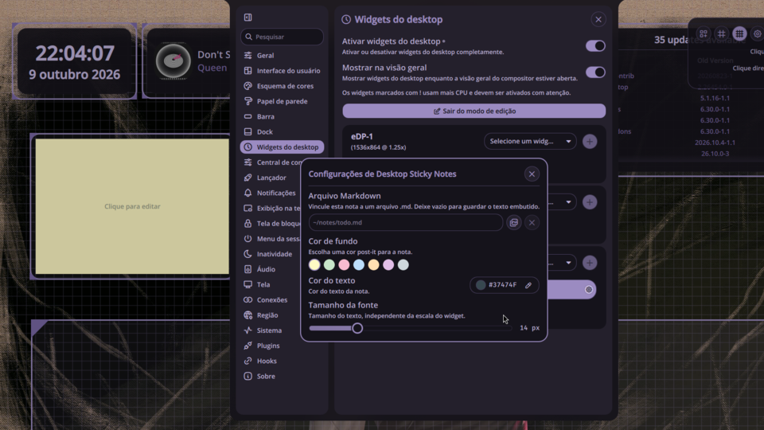

# Desktop Sticky Notes

A [Noctalia Shell](https://noctalia.dev) (Quickshell) plugin that pins sticky notes on your
desktop as **desktop widgets**. Each note is a draggable, scalable instance with Markdown text,
a post-it background color, a text color and a font size. Clicking a note opens a focused popup
editor.

> **Status:** working MVP on Noctalia 4.7.7 (min `4.6.6`). Not yet published to the
> [noctalia-plugins](https://github.com/noctalia-dev/noctalia-plugins) registry.
> See [`docs/specs/`](docs/specs/) for the spec and [`docs/plans/`](docs/plans/) for the plan.

## Screenshot



## Features

- **Per-instance notes.** Add as many notes as you want; each keeps its own text, colors, font size, position and scale.
- **Markdown.** Notes render Markdown (bold, italic, code, lists, task lists, quotes, tables, links) as read-only RichText on the desktop.
- **Focused editor.** Clicking a note opens a popup panel with keyboard focus (a shell window), so you can actually type.
- **Post-it palette.** Pick a background color from a post-it style palette.
- **Customizable.** Per-note text color, font size and independent width/height, all separate from the widget scale.
- **File-backed notes.** Optionally link a note to a `.md` file on disk: the file becomes the note's source of truth (read and edited in place), with live updates when the file changes externally. Leave it empty to store the text inline.
- **Scrollable.** Long notes scroll with the mouse wheel and show a scrollbar.
- **Persistent.** Notes survive shell restarts (state stored in Noctalia's desktop widget settings).
- **i18n.** English and Portuguese.

## Requirements

- Noctalia Shell `>= 4.6.6` (developed against 4.7.7).
- Quickshell (bundled with Noctalia).

## Installation

This plugin lives in its own repository and is symlinked into Noctalia's plugin directory.

```bash
git clone git@github.com:nandomoreirame/noctalia-desktop-sticky-notes.git
ln -sfn "$(pwd)/noctalia-desktop-sticky-notes" \
        ~/.config/noctalia/plugins/desktop-sticky-notes
```

Restart the shell (`Super+Alt+B` or `qs -c noctalia-shell`), then enable **Desktop Sticky Notes**
in Settings → Plugins.

## Usage

1. Open **Settings → Desktop Widgets** and enter edit mode.
2. Add a **Desktop Sticky Notes** widget. An empty note appears on the desktop.
3. Drag to position it; use the corner handles to scale it.
4. Exit edit mode and **click the note** to open the editor.
5. Type Markdown, pick a background/text color and a font size, then save (`Ctrl+S` or `Esc`).

In edit mode, right-click a note for the context menu (reset / raise / lower / delete / widget settings).

## Customization

| Property | Where | Default |
|----------|-------|---------|
| Text (Markdown) | Popup editor | empty |
| Background color | Popup editor (post-it palette) | `#FFF9C4` |
| Text color | Popup editor (`NColorPicker`) | `#37474F` |
| Font size | Popup editor (slider) | `14` |
| Width / height | Popup editor (sliders) | `200 x 140` |
| Markdown file | Widget settings (text field + file picker) | empty (inline text) |
| Position / scale | Drag + corner handles (edit mode) | auto |

### File-backed notes

Open a note's **widget settings** (right-click in edit mode) and set a **Markdown file**
path (`~` is expanded). From then on that note reads and writes that `.md` file instead of
storing text inline: edits in the popup editor are saved to the file, and external edits
to the file show up in the note live. The file is created on first save if it does not exist.
Clearing the path unlinks the note (the file is kept) and restores its inline text.

## Development

The JS logic under `utils/` (`markdown.js`, `palette.js`, `scroll.js`, `dimensions.js`, `filepath.js`)
is covered by Vitest unit tests; the QML UI is verified by reloading the shell and watching the logs.

```bash
# JS unit tests (Vitest)
npm install
npx vitest run

# reload the running shell and watch for QML errors
qs -c noctalia-shell &
journalctl --user -b 0 | grep -iE "noctalia|quickshell" | tail -30
```

See [`CLAUDE.md`](CLAUDE.md) for conventions (English code, Conventional Commits, strict TDD for JS)
and [`docs/CONTEXT.md`](docs/CONTEXT.md) for the full design handoff.

## License

MIT (c) Fernando Moreira
